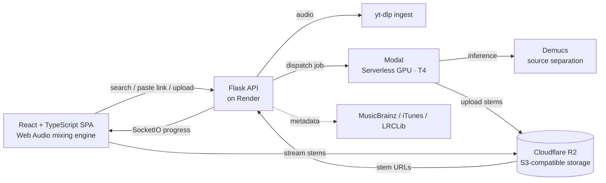

<div align="center">

# 🎚️ SlicerSmthng

### An AI-powered practice workstation that splits any song into its individual instruments.

Search a song or paste a link, get isolated **vocals · drums · bass · guitar · piano** — then mute what you play, slow it down without changing pitch, loop the hard bar, and rehearse against a beat-aligned metronome.


-EE4C2C?logo=pytorch&logoColor=white)


</div>

---

## What it is

Learning a song by ear is hard when every instrument is glued into one stereo mix. **SlicerSmthng** takes a song — from an in-app YouTube search, a YouTube/SoundCloud/Bandcamp link, or an uploaded file — and uses a deep-learning source-separation model to pull it apart into individual instrument stems. It then hands those stems to a browser-based mixing engine built for practice: solo the guitar to learn a riff, mute the vocals for karaoke, drop the tempo to 75% **without dropping the pitch**, loop four bars until they're clean, and run a metronome locked to the actual beat grid.

It's the tool I wanted as a musician: a rehearsal room where you control every instrument independently.

> **Live demo:** [slicersmthng.onrender.com](https://slicersmthng.onrender.com) — access-gated (it's used by a private band). See the screenshots below, or reach out for a walkthrough.

<!-- TODO: add screenshots / a short GIF here — they make the biggest difference on a portfolio.
     Great candidates: the expanded player with the colored multi-stem waveform, the mixer grid,
     and the metronome drag-to-align mode. Drop them in a docs/ folder and reference below. -->
<!--  -->

---

## Highlights

| | |
|---|---|
| 🎛️ **Up to 6 isolated stems** | Vocals, drums, bass, guitar, piano, other — via Hybrid-Transformer Demucs on GPU |
| ⏱️ **Pitch-neutral tempo** | Slow to 50–120% with no chipmunk effect (granular time-stretch), plus independent ±12-semitone pitch shift |
| 🎚️ **Real-time stem mixer** | Per-stem volume / mute / solo, mixed live in the browser with the Web Audio API |
| 🌊 **Multi-stem colored waveform** | Every instrument drawn in its own color on one canvas, with a draggable beat grid + zoom |
| 🥁 **Beat-aligned metronome** | Auto-detected BPM + downbeat, a visual drag-to-align editor, and multi-tempo-region support |
| 🔁 **A/B looping** | Snap-to-bar loop points for drilling a section |
| 🎤 **On-demand refinement** | Split vocals into lead + backing (a second neural net), or a stereo stem into L/R channels |
| 📝 **Synced lyrics + key/chord detection** | LRCLib-synced lyrics that scroll with playback; key & chords from DSP analysis |
| 📥 **Stem export** | Download selected stems as separate files or merged into one backing-track mp3 |
| 🎵 **Setlists** | Group songs, carry mixer state across tracks, auto-advance with prefetch for gapless practice |

---

## Architecture

The interesting engineering isn't a single model call — it's orchestrating a **serverless GPU**, **object storage**, and a **real-time audio engine** into one responsive app on a free-tier budget.



**Request lifecycle:** the SPA sends a link to the Flask API → `yt-dlp` pulls the audio → the job is dispatched to a **Modal** serverless GPU that runs **Demucs** inference → separated stems are uploaded straight to **Cloudflare R2** → the browser streams them back and mixes them live. Job progress streams to the UI over **SocketIO**.

---

## The engineering problems worth talking about

These are the decisions that shaped the build:

- **Serverless GPU instead of a dedicated one.** Stem separation needs a GPU, but a GPU idling between jobs is expensive. Modal spins one up *per job* and bills only for the seconds of inference — the whole thing runs on free credits. The Flask backend dispatches the job, streams progress over SocketIO, and never touches a GPU itself. The separation step sits behind a backend-agnostic interface, so the `STEM_SEPARATOR` env var swaps between the Modal path and a Replicate hosted-API fallback without changing the rest of the pipeline; the hosted demo runs Modal.

- **Surviving an ephemeral filesystem.** The app is hosted on a free tier whose disk is wiped on every restart/cold-start. Early on, songs and setlists silently vanished after the server slept. Fix: stems, metadata, setlists, and mix snapshots all persist to **Cloudflare R2** (S3-compatible), and the backend rehydrates its local cache from R2 on boot — in a background thread, so the port binds fast enough to pass the platform's health check.

- **Pitch-neutral time-stretch in the browser.** A naive `playbackRate` change speeds up *and* raises pitch. The player uses **Tone.js GrainPlayer** (granular synthesis) so tempo and pitch are independent controls — slow a solo to 60% and it stays in the original key.

- **A near-sample-accurate metronome.** Web Audio schedules clicks ~250 ms ahead for glitch-free timing, which normally means UI changes lag. The engine tracks pending click buffers and cancels the queued-but-unplayed ones the instant you re-align the grid, so a drag/tap takes effect within ~10 ms instead of a full beat later. It also supports **multiple tempo regions per song** for tracks that change tempo mid-way.

- **Custom multi-stem waveform.** Replaced an off-the-shelf waveform library with a hand-written dual-canvas renderer (a static layer for waveforms + beat grid, a dynamic layer for the playhead) that draws all six stems in their own colors and supports zoom for precise beat alignment.

---

## AI / ML

To be precise about what's under the hood — this is **inference on pretrained models plus classical signal processing**, not model training:

- **Demucs (Hybrid-Transformer Demucs)** — a pretrained deep-learning model (Meta Research) for music source separation. This is the core: it takes a stereo mix and outputs isolated instrument stems. Runs as a GPU inference service on Modal.
- **UVR-MDX-NET** — a second pretrained neural network (ONNX) used on demand to split a vocal stem into lead vs. backing vocals.
- **Classical MIR / DSP (librosa)** — beat/BPM tracking via onset detection, musical-key estimation via Krumhansl–Schmuckler chroma template matching, and chord recognition via template matching against 24 major/minor triads. No neural nets here — these are traditional signal-processing algorithms.

The engineering contribution is the **integration**: wiring these models into a serverless GPU pipeline, persisting and serving their output, and building a real-time interface on top of it.

---

## Tech stack

| Layer | Technology |
|---|---|
| **Frontend** | React 19, TypeScript, Vite, Tailwind CSS, Zustand (state), Tone.js (Web Audio), framer-motion, React Router |
| **Backend** | Python, Flask, Flask-SocketIO |
| **ML / audio** | Demucs (PyTorch) · UVR-MDX-NET (ONNX) · librosa (DSP) |
| **Infrastructure** | Modal (serverless GPU inference) · Cloudflare R2 (object storage) · Render (hosting) · Docker |
| **Ingestion / data** | yt-dlp (+ Node for YouTube's JS challenges) · LRCLib (lyrics) · MusicBrainz (metadata) · iTunes Search (album art) |

---

## Running it locally

> Stem separation runs through a pluggable backend chosen by `STEM_SEPARATOR`: **Modal** (serverless GPU — what the hosted demo uses) or **Replicate** (a hosted Demucs API, and the code's default). The quickstart below sets up the Modal path; either way, pair it with a Cloudflare R2 bucket for persistent storage. All of these have generous free tiers.

```bash
# 1. Backend
python -m venv venv && source venv/bin/activate
pip install -r requirements.txt

# 2. Frontend
cd frontend && npm install && npm run build && cd ..

# 3. Deploy the GPU separation function (one-time)
pip install modal && modal token new
modal deploy modal_demucs.py        # prints your MODAL_DEMUCS_URL

# 4. Point the app at Modal + add your R2 creds (see the env table below), then run
export STEM_SEPARATOR=modal         # otherwise it defaults to the Replicate backend
python server.py                    # serves API + built SPA
```

Key environment variables (set on the host, never committed):

| Variable | Purpose |
|---|---|
| `STEM_SEPARATOR` | Which backend runs separation: `modal` or `replicate`. **Defaults to `replicate`** when unset; the hosted demo sets it to `modal`. |
| `MODAL_DEMUCS_URL` | Endpoint of the deployed Modal separation function — required when `STEM_SEPARATOR=modal` |
| `MODAL_KARAOKE_URL` | Endpoint of the deployed vocal-split function (optional feature) |
| `REPLICATE_API_TOKEN` | Required when `STEM_SEPARATOR=replicate` (the default) — token for Replicate's hosted Demucs |
| `R2_ACCOUNT_ID`, `R2_ACCESS_KEY_ID`, `R2_SECRET_ACCESS_KEY`, `R2_BUCKET`, `R2_PUBLIC_URL_BASE` | Cloudflare R2 credentials for persistent stem/metadata storage |
| `SITE_PASSWORD` | Optional — gates the whole app behind a shared password |

For frontend hot-reload during development: `cd frontend && npm run dev`.

---

## Project structure

```
slicersmthng/
├── server.py             # Flask entrypoint (API + static SPA + auth gate)
├── modal_demucs.py       # Serverless GPU function: Demucs separation + BPM/key/chord
├── modal_karaoke.py      # Serverless GPU function: lead/backing vocal split (UVR)
├── backend/
│   ├── routes.py         # REST API (import, jobs, songs, stems, tempo, split, download…)
│   ├── jobs.py           # Import pipeline: ingest → separate → analyze → persist
│   ├── storage.py        # Cloudflare R2 persistence + boot-time rehydration
│   ├── split.py          # On-demand stem refinement (karaoke / L-R)
│   ├── download.py       # Merge-to-mp3 / zip stem export
│   └── metadata.py       # MusicBrainz + iTunes enrichment
└── frontend/src/
    ├── lib/audioEngine.ts             # Web Audio mixing engine + metronome scheduler
    ├── components/PlayerExpanded.tsx  # Full mixer / tempo / loop / align UI
    ├── components/WaveformView.tsx    # Multi-stem canvas waveform + beat grid
    └── stores/                        # Zustand state (player, library, setlists, jobs)
```

---

## Roadmap

- [x] In-app search & import (yt-dlp search → pick a result → slice)
- [ ] Chord-annotated lyrics (overlay detected chords on synced lyric lines)
- [ ] Visual metronome + count-in overlay
- [ ] Saveable mixer presets per song

---

<div align="center">
<sub>Built as a real tool for real practice sessions. The separation models are pretrained and run as inference services — the project is the system engineered around them.</sub>
</div>
